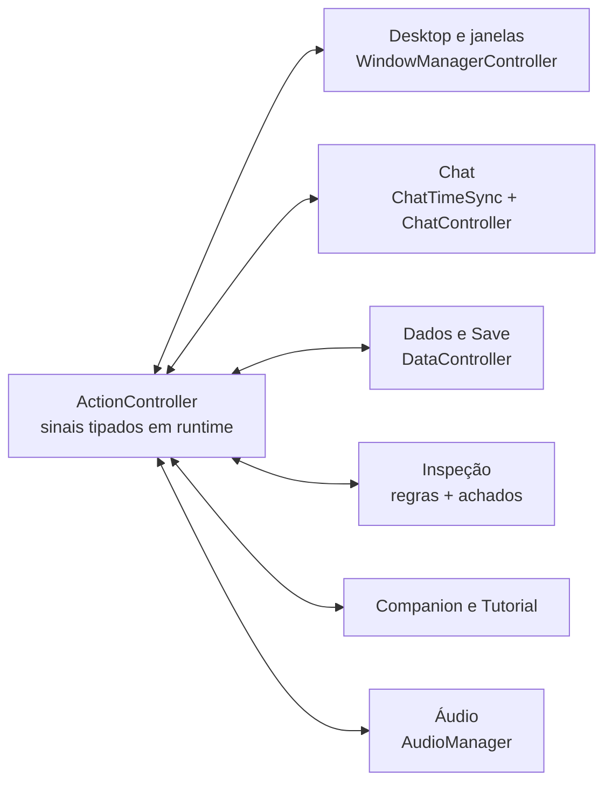

# Re:Senha

Re:Senha é um serious game em Unity e C# sobre cibersegurança e prevenção de
engenharia social. O jogador trabalha como analista de segurança na NationalTech,
avaliando mensagens e documentos em um desktop fictício.

## Sobre o jogo

O jogo foi criado para praticar decisões seguras diante de e-mails, conversas e
solicitações de trabalho. O jogador aprende a verificar remetentes, links e anexos,
consultar regras, reunir evidências e decidir quando aprovar, bloquear ou rejeitar
uma solicitação.

O público inclui estudantes e pessoas em treinamento de segurança da informação.
O conteúdo aborda phishing, urgência artificial, falsificação, anexos suspeitos e
outros sinais de engenharia social. O Manual e o Companion oferecem orientação
durante o expediente.

## Estado do projeto

O estado abaixo descreve sistemas encontrados no código e nos assets; não é uma
declaração de que cada fluxo foi validado em uma build de distribuição.

| Sistema | Situação observada |
|---|---|
| Desktop, relógio e ciclo de dias | Implementados. A cena Desktop está configurada para 08:00–18:00 em cinco minutos reais. |
| Companion e tutorial | Implementados com dicas em `CompanionTips.json` e eventos de tutorial. |
| Chat | Conversas em ScriptableObjects, chegadas agendadas, escolhas, mensagens agendadas e persistência implementadas. |
| E-mail | Filas diárias em JSON, caixas User/Company, anexos e decisões de segurança implementados. Há arquivos para os dias 1–5. |
| Inspeção | Avaliação de regras e registro de achados implementados para e-mail; o Database fornece uma superfície de consulta contextual. |
| Tickets | Decisões e feedback implementados. Só foi encontrado `Tickets/Dia_1.json`; não há JSON de ticket para os dias 2–5. Tickets não entram na verificação que libera o fim do dia. |
| Pontuação de segurança | Opções de chat podem emitir `ChatSecurityScoreDelta`; não foi encontrado consumidor desse sinal. A pontuação ponta a ponta está **A confirmar**. |
| Estatísticas e achievements | Há modelos em `MetaData`; coleta e apresentação funcionais estão **A confirmar**. |

## Requisitos

- Unity Editor **6000.5.9f1** (`ProjectSettings/ProjectVersion.txt`).
- Universal Render Pipeline **17.6.0**.
- Input System **1.20.0** e `Assets/Settings/InputSystem_Actions.inputactions`.
- UI/UGUI **2.5.0** e os assets TextMeshPro presentes em `Assets/Text Mesh Pro`,
  usados pelas interfaces. O manifesto não declara um pacote/versão independente
  de TextMeshPro (**A confirmar**).
- Newtonsoft JSON para Unity **3.2.2**.
- Os demais pacotes estão declarados em `Packages/manifest.json`.

## Como abrir e executar

1. Instale o Unity Hub e o Unity Editor 6000.5.9f1.
2. No Unity Hub, adicione a raiz deste repositório como projeto.
3. Aguarde a importação dos assets e a resolução dos pacotes.
4. Abra `Assets/Scenes/MainMenu.unity` e pressione **Play**.
5. Para iniciar diretamente no desktop pelo Editor, abra `Assets/Scenes/Desktop.unity`.

As cenas habilitadas em Build Settings são `MainMenu`, `Desktop`, `GameOver` e
`GameWin`. Os saves ficam em `Application.persistentDataPath`; o local varia por
plataforma. Veja [Sistema de Save](./Wiki/Sistema-de-Save.md).

## Estrutura do projeto

| Caminho | Conteúdo |
|---|---|
| `Assets/Scripts/DTO/` | `ActionController`, `DataController`, modelos compartilhados e utilitários de interação. |
| `Assets/Scripts/Chat/` | Dados, sincronização, decisões e interface do chat. |
| `Assets/Scripts/Desktop/` | Janelas, apps, relógio, taskbar, Companion, inspeção e progresso diário. |
| `Assets/Scripts/Tutorial/` | `TutorialManager` e sinais de tutorial. |
| `Assets/Scripts/Audio/` | `AudioManager`, controles de volume e áudio de interface. |
| `Assets/Editor/` | Ferramentas de Editor, incluindo o gerador de conversas. |
| `Assets/Resources/` | JSON e recursos carregados por caminho em runtime: e-mails, tickets, regras, imagens, Companion e wallpapers. |
| `Assets/Scriptable Objects/` | Conteúdo de chat em assets Unity, inclusive `ChatInbox`, conversas e nós. |
| `Assets/Prefabs/` | Janelas, apps, UI, Companion e itens de listas. |
| `Assets/Scenes/` | Menu, desktop e cenas de encerramento. |
| `Assets/Settings/` | Configurações do URP e ações do Input System. |
| `Packages/` e `ProjectSettings/` | Pacotes, versão do Unity, cenas de build e configurações do projeto. |

## Arquitetura em alto nível

`ActionController` é um barramento estático de sinais identificados por string.
Ele permite publicação sem referência direta entre sistemas, mas emissor e
assinante precisam usar exatamente o mesmo tipo de payload.



Para responsabilidades, sinais e fluxo entre componentes, consulte
[Arquitetura](./Wiki/Arquitetura.md).

## Como contribuir

1. Crie uma branch de trabalho, por exemplo:

   ```sh
   git switch -c docs/descricao-curta
   ```

2. Mantenha os textos apresentados ao jogador em pt-BR e siga os nomes e padrões
   existentes no código. Identificadores de C# existentes são majoritariamente
   em inglês; não os traduza ao acrescentar conteúdo.
3. Use `ActionController` para comunicar sistemas desacoplados quando houver um
   sinal apropriado. Ao criar assinatura, remova-a no ciclo de vida correspondente.
   O tipo genérico do sinal deve coincidir exatamente entre envio e assinatura.
4. Use ScriptableObjects para conversas e nós de chat; use JSON em `Resources`
   para e-mails, tickets, regras do Manual e dicas do Companion. Saves de runtime
   são JSON gerado pelo jogo, não conteúdo para editar manualmente.
5. Para regenerar as conversas padrão, use **Tools > Re:Senha > Gerar Conversas**.
   O gerador lê specs privadas em `Assets/Editor/ChatContentGenerator.cs` e pode
   sobrescrever campos dos assets gerados; revise os efeitos antes de executá-lo.
6. Para adicionar uma dica, edite `Assets/Resources/Companion/CompanionTips.json`,
   atribua um `id` único e dispare `CompanionSignals.Show("id")`. Consulte
   [Companion e Tutorial](./Wiki/Companion-e-Tutorial.md).
7. Abra um pull request com uma descrição do comportamento alterado e como foi
   verificado. O repositório não documenta um pipeline de testes de gameplay.

## Créditos, licença e links

- **Equipe/autoria:** Nuntius Studio.
- **Instituição/parceiros:** UNESP.
- **Licença do código e dos assets:** **A confirmar**; não foi localizado arquivo
  de licença no repositório.
- **Atribuições de terceiros:** revisar fontes, sprites, músicas e pacotes antes
  de uma distribuição.
- **Issues:** [GitHub Issues](https://github.com/Sortudo13/RE-SENHA/issues).
- **Wiki local:** [índice de documentação](./Wiki/Home.md). A URL da GitHub Wiki
  redireciona para a página do repositório; as páginas consultadas estão versionadas
  em `Wiki/`.
- **Documento de design:** **A confirmar**; não foi localizado no repositório.

## Documentação

Comece pela [Wiki](./Wiki/Home.md), que reúne guias para desenvolvimento,
autoria de conteúdo e avaliação pedagógica.
