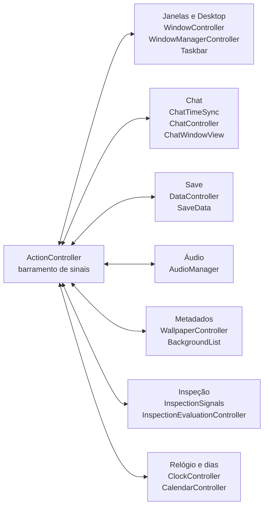
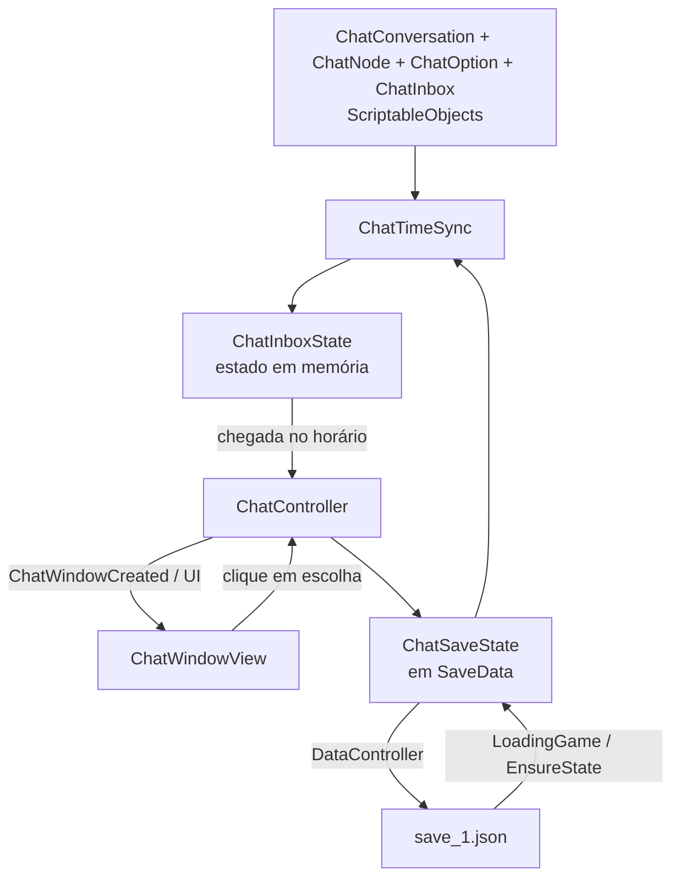

# Re:Senha

Serious game de cibersegurança e prevenção de engenharia social, desenvolvido em Unity
com C#. O jogador atua como analista de segurança da NationalTech em um desktop
fictício retrô e aprende a reconhecer, investigar e decidir sobre comunicações
potencialmente maliciosas.

## Visão geral

### Público e objetivo pedagógico

O público é formado por pessoas que precisam praticar decisões de segurança em
comunicações digitais. O objetivo é transformar conceitos de phishing, engenharia
social e análise de evidências em decisões observáveis: ler o contexto, consultar
regras, inspecionar campos e aprovar, bloquear ou responder adequadamente.

### Loop de jogo

1. Abrir o projeto na cena `MainMenu` e iniciar a jornada.
2. Trabalhar nos dias disponíveis no desktop da NationalTech.
3. Receber e analisar e-mails, tickets e conversas quando o relógio do expediente
   atingir seus horários.
4. Abrir anexos, consultar o Manual, o Banco de Dados e o modo de inspeção.
5. Registrar decisões e achados; o jogo apresenta feedback e estatísticas.
6. Avançar o dia até `GameWin` ou atingir a condição de `GameOver`.

O conteúdo de chat atualmente identifica Clip como aliado e Odisseu como antagonista
nos assets gerados; personagens e horários são dados de conteúdo, não uma enumeração
hard-coded no runtime.

## Requisitos

- Unity **6000.5.9f1** (`ProjectSettings/ProjectVersion.txt`).
- Universal Render Pipeline **17.6.0**.
- Input System **1.20.0**, com ações em
  `Assets/Settings/InputSystem_Actions.inputactions`.
- TextMeshPro/UGUI (`com.unity.ugui` 2.5.0).
- Newtonsoft JSON para Unity (`com.unity.nuget.newtonsoft-json` 3.2.2).
- Test Framework 1.7.0 (disponível no projeto; não há suíte de testes runtime
  documentada nesta inspeção).
- Pacotes e módulos adicionais estão registrados em
  `Packages/manifest.json`; a lista completa deve ser mantida pelo Unity Package
  Manager.

## Como abrir e executar

1. Instale o Unity Hub e o Unity Editor 6000.5.9f1.
2. Abra a raiz do repositório como projeto Unity.
3. Aguarde a importação dos assets e a resolução dos pacotes.
4. Abra `Assets/Scenes/MainMenu.unity` ou use **File > Build Settings**.
5. Execute no Editor. As cenas de build já estão configuradas na ordem
   `MainMenu`, `Desktop`, `GameOver`, `GameWin`.

Os saves são gravados em `Application.persistentDataPath` como `save_1.json` e
`data.json`; a localização concreta varia por plataforma.

## Estrutura real

```text
Assets/
  Editor/                         Ferramentas Unity Editor
  Prefabs/                        Janelas, apps, chat, listas e alertas
  Resources/
    Background/                  Wallpapers
    Emails/                       Dia_1.json ... Dia_5.json
    Tickets/                      Tickets por dia
    Manual/                       ManualRules.json
    Database/                     Database_Base.json
    Images/                       Imagens referenciadas por conteúdo
  Scenes/                         MainMenu, Desktop, GameOver, GameWin
  Scriptable Objects/Chat/        Conversas, nós e ChatInbox gerados no Editor
  Scripts/
    Chat/                         Dados, sincronização e UI do chat
    Desktop/                      Janelas, apps, relógio, inspeção e taskbar
    DTO/                          Barramento, save e modelos compartilhados
    Audio/                        Música, SFX e slider
    MainMenu/, Cursor/, Fonts/    Fluxos auxiliares
    Other Scenes/, SceneLoading/  Transição e encerramento
  Settings/                       URP e Input System
Packages/                         Manifesto e lock de pacotes
ProjectSettings/                  Versão, cenas de build e configurações Unity
```

## Arquitetura

`ActionController` é um registro estático de delegates. Não há enum de eventos:
os sinais são strings e o tipo do payload precisa ser idêntico entre emissor e
assinante.



### Janelas e desktop

`WindowController` controla foco, minimização, troca e destruição de uma janela.
`WindowManagerController` instancia apps, limita janelas ativas e encaminha
`AttachmentContent` para o app correto. `MovementController`, `NewMovementController`,
`SwapController` e `ZoomController` implementam interação da janela. A taskbar
mantém botões sincronizados com `WindowCreated`, `WindowDestroyed_*` e `ToFront_*`.

Pontos de extensão: adicionar um prefab de app, um `DocumentType`, o método de
inicialização correspondente no Window Manager e o ícone/ação da taskbar.

### Chat

O conteúdo estático é composto por `ChatConversation`, `ChatNode`, `ChatOption` e
`ChatInbox` (ScriptableObjects). `ChatInboxState` mantém chegada, leitura, nó atual
e término. `ChatTimeSync` converte o relógio em chegadas. `ChatController` orquestra
histórico, escolhas e persistência; `ChatWindowView` instancia os prefabs
`ConversationItem`, `MessageBubbleNpc`, `MessageBubblePlayer`,
`MessageBubbleTyping` e `ChoiceButton`.

Há uma conversa agendada por entrada de inbox. A chegada é descartada se o dia
agendado já passou, portanto não existe entrega retroativa. O avatar vem da
conversa e é aplicado apenas no cabeçalho da janela.

### Save e dados

`DataController` carrega dados diários de `Resources`, mantém `CurrentSave` e
`CurrentMetaData`, serializa com Newtonsoft JSON e publica `DayChanged`. O save
principal contém dia, erros, hora, e-mails, caixas, tickets e `chatStates`.
`ChatSaveState` também guarda `currentNodeId`, flags de chegada/leitura/término e
histórico de mensagens. `PlayerPrefs` armazena valores pequenos de progresso e
volumes.

### Áudio

`AudioManager` é singleton persistente entre cenas, com `AudioSource` para BGM e
SFX. Toca música do menu, playlist do Desktop, fade/silêncio entre faixas e sons
de UI, aprovação, vitória e derrota. Volumes `MusicVolume` e `SFXVolume` são
validados, salvos em `PlayerPrefs` e controlados por `MusicSliderController`.

### Metadados e wallpaper

`BackgroundList` carrega todos os sprites em `Resources/Background`. Cada
`BackgroundButton` publica `SetWallpaper`; `WallpaperController` aplica o sprite,
atualiza `MetaData.currentBackground` e salva `data.json`. A escolha persiste
independentemente do save diário.

### Relógio, dias e encerramento

`ClockController` mapeia cinco minutos reais para o intervalo configurado
08:00–16:00, publica `TimeUpdated`, `WorkStarted` e `WorkEnded`. O calendário
avança, retrocede, reseta ou carrega dias. `DayProgressController` e
`AlertManagerController` conduzem o encerramento e as transições para as cenas
finais.

## Fluxo de dados do chat



## Sinais do ActionController e assinantes

| Sinal | Payload | Assinantes extraídos do código |
|---|---|---|
| `DayChanged` | — | `ClockController`, `CalendarController`, `ChatTimeSync`, `WindowManagerController`, `IconController`, `ManualWindowController` |
| `TimeUpdated` | — | `ClockController`, `ChatTimeSync` |
| `WorkStarted` | — | `SenderController` |
| `WorkEnded` | — | `DayProgressController` |
| `SaveGame` | — | `ChatController` |
| `ChatWindowCreated` | `ChatWindowView` | `ChatController` |
| `ChatConversationArrived` | `string` | `ChatController` |
| `WindowCreated` | `WindowData` | `TaskbarManagerController` |
| `WindowDestroyed_{id}` | — | `TaskbarButtonController` |
| `ToFront_{id}` | — | `TaskbarButtonController`, `WindowController` |
| `Swap_{id}` | — | `WindowController` |
| `MinimizeAllWindow` | `bool` | `WindowController` |
| `AddActiveWindow` / `SubActiveWindow` | — | `WindowManagerController` |
| `DestroyWindows` | — | `WindowManagerController` |
| `OpenURL` | `string` | `WindowManagerController` |
| `InitEmail` / `InitManual` / `InitPDF` / `InitPNG` / `InitRG` / `InitChat` | `AttachmentContent` | `WindowManagerController` |
| `OpenAttachment` | `string` | `EmailController` |
| `ShowList` | — | `EmailController` |
| `MailChanged` | `string` | `EmailController` |
| `RemoveEmail` | `EmailData` | `EmailController` |
| `ShowNotificationBadge` / `HideNotificationBadge` | `string` | `EmailController`, `IconController` |
| `SetWallpaper` | `Sprite` | `WallpaperController` |
| `OnWindowClosed` / `OnWindowOpened` / `OnButtonClicked` / `OnApprovalButtonClicked` | — | `AudioManager` |
| `ShowFeedback` | `FeedbackData` | `AlertManagerController` |
| `ShowNextDay` / `ShowBlockedWindow` | — | `AlertManagerController` |
| `ShowFindings` | `string[]` | `AlertManagerController` |
| `ShowFindingNotification` | — | `AlertManagerController` |

O subsistema de inspeção centraliza nomes e payloads em
`InspectionSignals.cs`; seus sinais seguem o mesmo mecanismo e são consumidos por
controladores de modo, seleção, apps e UI de achados. Consulte a tabela acima junto
com essa classe ao adicionar novos sinais.

## Tabela de scripts

| Script | Responsabilidade |
|---|---|
| `DTO/ActionController.cs` | Registro estático de sinais tipados |
| `DTO/DataController.cs` | Save, metadados, JSON, modelos de dados e `ChatSaveState` |
| `DTO/Properties/ActionButtonController.cs` | Publica um sinal a partir de botão |
| `DTO/SenderController.cs` | Agenda e envia e-mails/notificações |
| `DTO/WindowFocusController.cs` | Foco de janela |
| `Chat/Data/ChatConversation.cs` | Asset de conversa, lookup e validação de nós |
| `Chat/Data/ChatInbox.cs` | Agenda ordenada de conversas |
| `Chat/Data/ChatInboxState.cs` | Estado de chegada/leitura/progresso |
| `Chat/Data/ChatNode.cs` | Mensagem, ritmo, opções e término |
| `Chat/Data/ChatOption.cs` | Resposta, próximo nó, pontuação e tag |
| `Chat/Runtime/ChatController.cs` | Orquestra conversa, UI, histórico e save |
| `Chat/Runtime/ChatTimeSync.cs` | Sincroniza chat com dia/relógio |
| `Chat/UI/ChatWindowView.cs` | View da janela e instanciação de UI |
| `Chat/UI/ConversationListItemView.cs` | Item da lista de conversas |
| `Audio/AudioManager.cs` | Singleton de música, playlist, volume e SFX |
| `Audio/MusicSliderController.cs` | Slider de volume de música |
| `Audio/SceneButtonAudioController.cs` | SFX de botões de cena |
| `Desktop/Apps/Window/WindowController.cs` | Ciclo de vida, foco e minimização |
| `Desktop/Apps/Window/WindowManagerController.cs` | Criação e despacho de apps |
| `Desktop/Apps/Window/Properties/IconController.cs` | Existência e badges de ícones |
| `Desktop/Apps/Window/Properties/MovementController.cs` | Arraste de janela |
| `Desktop/Apps/Window/Properties/NewMovementController.cs` | Variante de movimento |
| `Desktop/Apps/Window/Properties/SwapController.cs` | Troca de estado de janela |
| `Desktop/Apps/Window/Properties/ZoomController.cs` | Zoom de conteúdo |
| `Desktop/Taskbar/TaskbarButtonController.cs` | Botão de janela na taskbar |
| `Desktop/Taskbar/TaskbarManagerController.cs` | Lista de botões da taskbar |
| `Desktop/Taskbar/Time/ClockController.cs` | Relógio e escala de tempo |
| `Desktop/Taskbar/Time/CalendarController.cs` | Navegação e carga de dias |
| `Desktop/Background/WallpaperController.cs` | Aplica e persiste wallpaper |
| `Desktop/Background/Properties/BackgroundButton.cs` | Seleção de sprite |
| `Desktop/Background/Properties/BackgroundList.cs` | Lista de wallpapers |
| `Desktop/DayProgress/DayProgressController.cs` | Encerramento do dia |
| `Desktop/WindowMenu/WindowMenuController.cs` | Menu de janelas |
| `Cursor/CursorController.cs` | Cursor customizado |
| `Cursor/Properties/CursorSwapController.cs` | Troca de cursor |
| `Desktop/Alert/AlertManagerController.cs` | Alertas, feedback e achados |
| `Desktop/InGameMenu/InGameMenuController.cs` | Menu durante o jogo e comando de save |
| `Desktop/Apps/Database/DatabaseData.cs` | Modelo de dados do banco |
| `Desktop/Apps/Database/DatabaseItemListController.cs` | Lista de itens do banco |
| `Desktop/Apps/Database/DatabaseRepository.cs` | Leitura do banco |
| `Desktop/Apps/Database/DatabaseWindowController.cs` | UI da janela de banco |
| `Desktop/Apps/Document/PDFController.cs` | Visualização PDF |
| `Desktop/Apps/Document/Properties/FlipController.cs` | Virada de documento |
| `Desktop/Apps/Document/Properties/LinkController.cs` | Links de documento |
| `Desktop/Apps/Email/EmailController.cs` | Inbox, leitura e anexos |
| `Desktop/Apps/Manual/ManualRuleCardController.cs` | Card de regra |
| `Desktop/Apps/Manual/ManualSubruleItemController.cs` | Subregra |
| `Desktop/Apps/Manual/ManualWindowController.cs` | Janela do manual |
| `Desktop/Apps/Ticket/TicketController.cs` | Decisão de tickets |
| `Desktop/Inspection/Core/InspectableItem.cs` | Superfície inspecionável |
| `Desktop/Inspection/Core/InspectionContracts.cs` | Contratos e modelos de inspeção |
| `Desktop/Inspection/Core/InspectionEvaluationController.cs` | Avaliação e achados |
| `Desktop/Inspection/Core/InspectionJudge.cs` | Julgamento de seleção |
| `Desktop/Inspection/Core/InspectionModeController.cs` | Ativação do modo |
| `Desktop/Inspection/Core/InspectionSelectionController.cs` | Seleção de campo/regra |
| `Desktop/Inspection/InspectionSignals.cs` | Catálogo de sinais de inspeção |
| `Desktop/Inspection/Rules/ManualRuleData.cs` | Dados de regra |
| `Desktop/Inspection/Rules/ManualRuleEvaluator.cs` | Avaliação de regra |
| `Desktop/Inspection/Rules/ManualRules.cs` | Carregamento de regras |
| `Desktop/Inspection/Apps/Database/DatabaseInspectionSurface.cs` | Inspeção de banco |
| `Desktop/Inspection/Apps/Email/EmailDecisionController.cs` | Decisão de e-mail |
| `Desktop/Inspection/Apps/Email/EmailInspectionSurface.cs` | Inspeção de e-mail |
| `Desktop/Inspection/UI/FindingsAlertWindow.cs` | Janela de achados |
| `Desktop/Inspection/UI/InspectionFieldSelectable.cs` | Campo selecionável |
| `Desktop/Inspection/UI/InspectionFindingsAlertController.cs` | Alertas de achados |
| `Desktop/Inspection/UI/InspectionModeButton.cs` | Botão de modo |
| `Desktop/Inspection/UI/InspectionRuleSelectable.cs` | Regra selecionável |
| `Desktop/Inspection/UI/InspectionSelectable.cs` | Base selecionável |
| `MainMenu/MainMenuController.cs` | Fluxo do menu |
| `MainMenu/FadeController.cs` | Fade de transição |
| `MainMenu/Credits/CreditsController.cs` | Créditos |
| `Other Scenes/GameOver/GameOverManager.cs` | Tela de derrota |
| `Other Scenes/GameRestartController.cs` | Reinício |
| `SceneLoading/LoadingScreen.cs` | Carregamento de cenas |
| `Fonts/ChangeAllFontsEditor.cs` | Ajuste de fontes no Editor |
| `Editor/ChatContentGenerator.cs` | Geração de conversas e `ChatInbox` no Unity Editor |

## Como adicionar conteúdo

### Nova conversa ou nó

1. Use **Tools > Re:Senha > Gerar Conversas** para gerar/atualizar os assets padrão
   em `Assets/Scriptable Objects/Chat/`.
2. Para conteúdo manual, crie `ChatConversation` e `ChatNode` em
   `Assets/Scriptable Objects/Chat/`, defina IDs únicos dentro da conversa, `startNodeId`
   e referências de `ChatOption`.
3. Adicione a conversa a um `ChatInbox`, definindo dia, hora, minuto e desempate.
4. Valide o Inspector: `ChatConversation` e `ChatInbox` denunciam IDs e referências
   inválidas no Editor.
5. Mantenha texto, tags e feedback em pt-BR; o avatar é configurado na conversa e
   aparece somente no cabeçalho.

### Novo wallpaper

Coloque o sprite em `Assets/Resources/Background/`. `BackgroundList` o descobrirá
automaticamente; o nome do asset será gravado em `MetaData.currentBackground`.

### Nova música

Atribua o `AudioClip` ao `mainMenuMusic` ou ao array `desktopPlaylist` do
`AudioManager` no prefab/objeto da cena. Preserve `AudioSource` separados para BGM e
SFX e ajuste volumes pelo Inspector ou `MusicSliderController`.

## Limitações conhecidas

- O barramento usa strings e delegates estáticos; erros de grafia ou de tipo de
  payload não são detectados pelo compilador.
- O conteúdo do chat é validado no Editor, mas uma referência ausente em runtime é
  apenas registrada e pode interromper o fluxo daquela conversa.
- Conversas que perderam o horário não são entregues retroativamente por decisão de
  `ChatInboxState.ProcessTime`.
- A lista de conteúdo diário depende de arquivos com convenções de nome em
  `Resources/Emails`, `Resources/Tickets`, `Resources/Manual` e `Resources/Database`.
- Não há suíte de testes automatizados de gameplay identificada nesta inspeção.
- O estado de preferências usa `PlayerPrefs`; o save JSON e os metadados são arquivos
  locais sem versionamento ou sincronização entre dispositivos.
- Estatísticas e achievements estão modelados em `MetaData`, mas parte da coleta
  ainda é dependente dos fluxos que os atualizam.

## Créditos e licença

- **Equipe/autoria:** Nuntius Studio.
- **Instituição/parceiros:** UNESP.
- **Licença do código e dos assets:** .
- **Terceiros e atribuições:** revisar licenças de fontes, sprites, músicas e pacotes.

## Wiki

As páginas prontas para publicação estão em [`Wiki/`](./Wiki/):

| Página | Conteúdo |
|---|---|
| [Home](./Wiki/Home.md) | Entrada, requisitos e navegação |
| [Arquitetura](./Wiki/Arquitetura.md) | Componentes, cenas, barramento e convenções |
| [Sistema de Chat](./Wiki/Sistema-de-Chat.md) | Assets, runtime, fluxo e extensão |
| [Sistema de Save](./Wiki/Sistema-de-Save.md) | JSON, PlayerPrefs e ciclo de vida |
| [Áudio](./Wiki/Audio.md) | Singleton, playlist, SFX e volumes |
| [Editor Tools](./Wiki/Editor-Tools.md) | Gerador de conversas e validações |
| [Metadados e Wallpaper](./Wiki/Metadados-Wallpaper.md) | `data.json`, Background e persistência |
