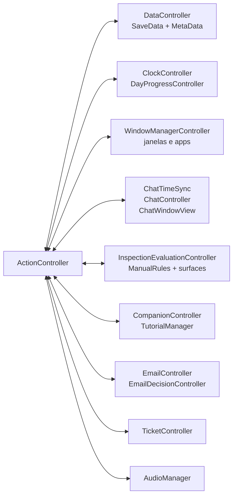

# Arquitetura

## Cenas e composição

As cenas habilitadas para build, nesta ordem, são `MainMenu`, `Desktop`,
`GameOver` e `GameWin`. `Desktop` reúne janelas, apps, taskbar, relógio,
Companion, inspeção, conteúdo do dia e interfaces de decisão.

## Componentes principais

| Componente | Responsabilidade |
|---|---|
| `ActionController` | Registro estático de delegates por string; envia sinais sem ou com um payload genérico. |
| `WindowManagerController` | Instancia janelas de apps/documentos e recebe `InitEmail`, `InitManual`, `InitPDF`, `InitPNG`, `InitRG` e `InitChat`. |
| `WindowController` | Foco, minimização, abertura/fechamento e ciclo de vida de uma janela. |
| `ChatTimeSync` | Converte relógio/dia em chegadas e mensagens de chat agendadas. |
| `ChatController` / `ChatWindowView` | Fluxo, histórico, persistência e apresentação de conversas. |
| `DataController` | Carrega dados diários, save por slot e metadados; serializa com Newtonsoft JSON. |
| `AudioManager` | Singleton persistente que controla playlist, áudio do menu e efeitos. |
| `CompanionController` / `TutorialManager` | Exibe dicas do JSON e liga eventos do jogo ao tutorial. |
| `InspectionEvaluationController` | Mantém superfícies abertas, avalia regras ativas e registra achados. |
| `EmailDecisionController` / `TicketController` | Aplicam regras de decisão específicas para e-mail e tickets. |

## Contrato de sinais

O emissor e cada assinante precisam usar o mesmo nome **e tipo de payload**.
`ActionController` armazena delegates tipados, mas o identificador é uma string;
erro de grafia ou tipo incompatível não é reportado ao emissor. Assinaturas devem
ser removidas ao desativar/destruir o objeto.

| Sinal | Payload | Quem dispara | Quem assina |
|---|---|---|---|
| `DayChanged` | nenhum | `DataController.LoadDay` / `LoadingGame` | `ClockController`, `CalendarController`, `ChatTimeSync`, `WindowManagerController`, `IconController`, `ManualWindowController` |
| `TimeUpdated` | nenhum | `ClockController` | `ChatTimeSync` e o próprio relógio para atualizar a UI |
| `WorkStarted` / `WorkEnded` | nenhum | `ClockController` | `SenderController` / `DayProgressController`, respectivamente |
| `ChatConversationArrived` | `string` (`conversationId`) | `ChatTimeSync` | `ChatController` |
| `ChatScheduledNodeArrived` | `string` (`conversationId:nodeId`) | `ChatTimeSync` | `ChatController` |
| `ChatWindowCreated` | `ChatWindowView` | `ChatWindowView` | `ChatController` |
| `TriggerEmail` | `string` (`triggerId`) | `ChatController` | `SenderController` |
| `CurrentEmailChanged` | `EmailData` (ou `null` ao fechar) | `EmailController` | `EmailDecisionController`, que publica/fecha a superfície de inspeção |
| `InspectionSurfaceChanged` | `IInspectionSurface` | `InspectionEvaluationController.PublishSurface` | `InspectionEvaluationController` |
| `InspectionFindingRegistered` | `string` (`findingId`) | seleção do Inspector | `InspectionEvaluationController` |
| `ShowFeedback` | `FeedbackData` | decisões de chat, e-mail e ticket | `AlertManagerController` |
| `ShowNotificationBadge` / `HideNotificationBadge` | `string` (nome do app) | `SenderController`, `ChatController` e controles de janela | `IconController`; `EmailController` também trata o badge de e-mail |
| `SetWallpaper` | `Sprite` | `BackgroundButton` | `WallpaperController` |
| `SaveGame` | nenhum | `InGameMenuController` | `ChatController`, que sincroniza o estado de chat no save |
| `CompanionShowTip` / `CompanionTipFinished` | `string` (`tipId`) | `CompanionSignals.Show` / `CompanionController` | `CompanionController` / `TutorialManager` |

O catálogo completo da inspeção está em
[`InspectionSignals.cs`](../Assets/Scripts/Desktop/Inspection/InspectionSignals.cs);
os sinais pedagógicos estão em
[`TutorialSignals.cs`](../Assets/Scripts/Tutorial/TutorialSignals.cs).

## Organização das responsabilidades

| Pasta | Exemplos | Fronteira |
|---|---|---|
| `Assets/Scripts/DTO/` | `ActionController`, `DataController`, `SenderController` | Sinais e modelos/dados compartilhados. |
| `Assets/Scripts/Chat/` | `ChatConversation`, `ChatTimeSync`, `ChatController` | Conteúdo, agendamento e UI do chat. |
| `Assets/Scripts/Desktop/Apps/` | E-mail, Manual, Database, Ticket, Document | Apps instanciados pelo desktop. |
| `Assets/Scripts/Desktop/Inspection/` | contratos, avaliador, regras e UI | Inspeção desacoplada dos apps via superfícies. |
| `Assets/Scripts/Tutorial/` e `Desktop/Companion/` | `TutorialManager`, `CompanionController` | Eventos de aprendizado e apresentação de dicas. |
| `Assets/Editor/` | `ChatContentGenerator` | Ferramentas que só rodam no Editor. |

## Extensão segura

- Prefira referências diretas dentro do mesmo componente e sinais entre sistemas
  independentes.
- Reutilize sinais existentes; se criar um, documente nome, payload, emissor e
  assinantes.
- Para conteúdo estático, use os formatos já existentes (ScriptableObjects ou JSON
  carregado por `Resources`); não persista conteúdo editorial no save do jogador.
- Mantenha os pontos de assinatura e remoção simétricos.

Veja [Chat](./Sistema-de-Chat.md), [Save](./Sistema-de-Save.md),
[Inspeção](./Sistema-de-Inspecao.md) e [Companion/Tutorial](./Companion-e-Tutorial.md).
