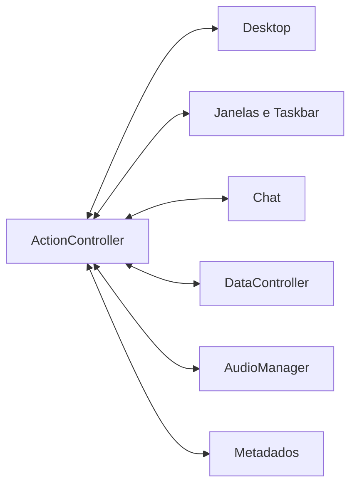

# Arquitetura

## Cenas e camadas

As cenas de build são `MainMenu`, `Desktop`, `GameOver` e `GameWin`. O Desktop
compõe janelas, taskbar, relógio, apps, chat, inspeção e wallpaper.

O barramento aceita `Action` sem payload ou `Action<T>` com correspondência exata de
tipo. Todo assinante deve remover sua inscrição no ciclo de vida do objeto.

## Convenções

- Classes de cena são `MonoBehaviour`; modelos serializáveis usam `[System.Serializable]`.
- Conteúdo estático é asset Unity ou JSON em `Resources`.
- IDs de conversa e nó são strings; IDs de nó são únicos dentro da conversa.
- Comunicação entre sistemas usa `ActionController`, não referências diretas quando
  um sinal já existe.
- Textos destinados ao jogador ficam em pt-BR.

