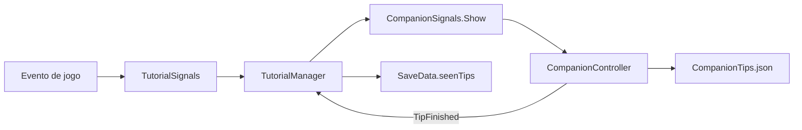

# Companion e Tutorial

## Como se relacionam

`CompanionController` lê dicas de `Resources/Companion/CompanionTips.json` e
apresenta uma fila de balões. `TutorialManager` escuta eventos de interface e
decisão e solicita dicas pelo ID. O texto fica nos dados; o código normalmente
envia apenas o identificador.



## Responsabilidades

| Classe | Responsabilidade |
|---|---|
| `CompanionController` | Assina `CompanionShowTip`, enfileira dicas, anima o prefab, apresenta linhas e publica `CompanionTipFinished`. |
| `CompanionTips` | Carrega/cacheia o JSON e lê/grava IDs vistos em `SaveData.seenTips`. |
| `CompanionData` | Define o formato serializável do livro, da dica e de cada linha. |
| `CompanionSignals` | Constantes `ShowTip`/`TipFinished` e método auxiliar `Show(tipId)`. |
| `TutorialManager` | Faz a sequência inicial e traduz eventos do jogo em IDs de dica. |
| `TutorialSignals` | Nomes dos eventos pedagógicos e seus payloads string. |

## Eventos do tutorial

Todos os sinais abaixo usam payload `string` e são recebidos por
`TutorialManager`.

| Sinal | Quem dispara | Exemplo de payload |
|---|---|---|
| `WindowOpened` | `IconController` | Nome do app, por exemplo `Email`. |
| `EmailRead` | `EmailController` | Assunto do e-mail. |
| `ChatOpened` / `ChoiceMade` | `ChatController` | `conversationId`. |
| `DecisionMade` | `EmailDecisionController` / `TicketController` | Tipo e referência da decisão, por exemplo `Email:<assunto>`. |
| `InspectionModeEntered` | `InspectionModeController` | `inspection`. |
| `DocumentOpened` | `WindowManagerController` | Tipo, como `PDF`, `PNG` ou `RG`. |
| `AlertReceived` | `AlertManagerController` | Categoria do alerta. |
| `CompanyMailboxOpened` / `EmailActionButtonsShown` | `EmailController` | Caixa ou assunto. |
| `FirstErrorCommitted` | `DayProgressController` | String vazia. |
| `DayEndApproaching` | `AlertManagerController` | String vazia. |
| `PauseMenuOpened` | `SwapController` | String vazia. |
| `TaskbarUsed` | `TaskbarButtonController` / `WindowManagerController` | Nome do app ou `show_desktop`. |
| `CompanionTipFinished` | `CompanionController` | ID da dica concluída. |

## Adicionar uma dica

Edite `Assets/Resources/Companion/CompanionTips.json`. Use um `id` único e uma ou
mais linhas:

```json
{
  "version": 1,
  "tips": [
    {
      "id": "conferir_remetente",
      "lines": [
        {
          "pose": "thinking",
          "anim": "",
          "text": "Confira o domínio do remetente antes de confiar na mensagem."
        }
      ]
    }
  ]
}
```

- `pose` deve corresponder a uma entrada em `poseSprites` no prefab Companion ou
  a um estado/trigger disponível no Animator. Sem correspondência, o script avisa
  e usa a expressão padrão.
- `anim` é opcional e deve corresponder a trigger ou estado no Animator.
- O Animator precisa do bool `Visible` e de estados com tags `Shown` e `Hidden`
  na camada zero. `Talking` é opcional.
- O JSON rejeita campos desconhecidos. IDs duplicados mantêm a primeira dica;
  dicas sem ID ou sem linhas são ignoradas com aviso.

Dispare a dica por código com:

```csharp
CompanionSignals.Show("conferir_remetente");
```

Ou envie diretamente `ActionController.SendAction<string>` com o sinal
`CompanionSignals.ShowTip`. O Companion ignora IDs inexistentes e dicas já vistas.
O ID é marcado como visto quando a dica começa a ser processada e persiste no save
do slot; reiniciar o dia mantém as dicas já vistas.

## Ligar um evento ao tutorial

`TutorialManager` já assina eventos como `WindowOpened`, `EmailRead`, `ChatOpened`,
`DecisionMade`, `InspectionModeEntered`, `DocumentOpened`, `AlertReceived`,
`FirstErrorCommitted`, `DayEndApproaching`, `PauseMenuOpened` e `TaskbarUsed`.
Os eventos são definidos em `TutorialSignals` e enviam `string`.

Para adicionar uma ligação:

1. Acrescente uma constante em `TutorialSignals` se não houver uma apropriada.
2. Envie-a no ponto em que o comportamento realmente ocorre, usando payload
   string.
3. Assine/remova a assinatura em `TutorialManager.OnEnable`/`OnDisable`.
4. Associe um ID existente no JSON e teste um slot novo: dicas já vistas não
   reaparecem no mesmo slot.

O tutorial inicial usa `tutorial_welcome`, `tutorial_open_email`,
`tutorial_read_email` e `tutorial_finished`. O Companion também pode ser acionado
por `EmailData.companionTip` ao abrir um e-mail.

## Troubleshooting rápido

- **Companion invisível ou desativado:** confira Animator Controller, Animator,
  Portrait, Bubble e texto no prefab; `Awake` desativa o componente se referências
  obrigatórias faltarem.
- **Pose/anim não funciona:** confira o nome no `poseSprites`/Animator e as tags
  `Shown`/`Hidden`; os avisos do Console indicam nome ou estado ausente.
- **Dica não reaparece durante teste:** use outro slot de save ou limpe o progresso
  de teste pelo fluxo do jogo; `seenTips` é armazenado no save.
- **Dica não é encontrada:** confirme o ID, a capitalização e a localização
  `Resources/Companion/CompanionTips.json`.

Mais diagnósticos estão em [Troubleshooting e glossário](./Troubleshooting-e-Glossario.md).
