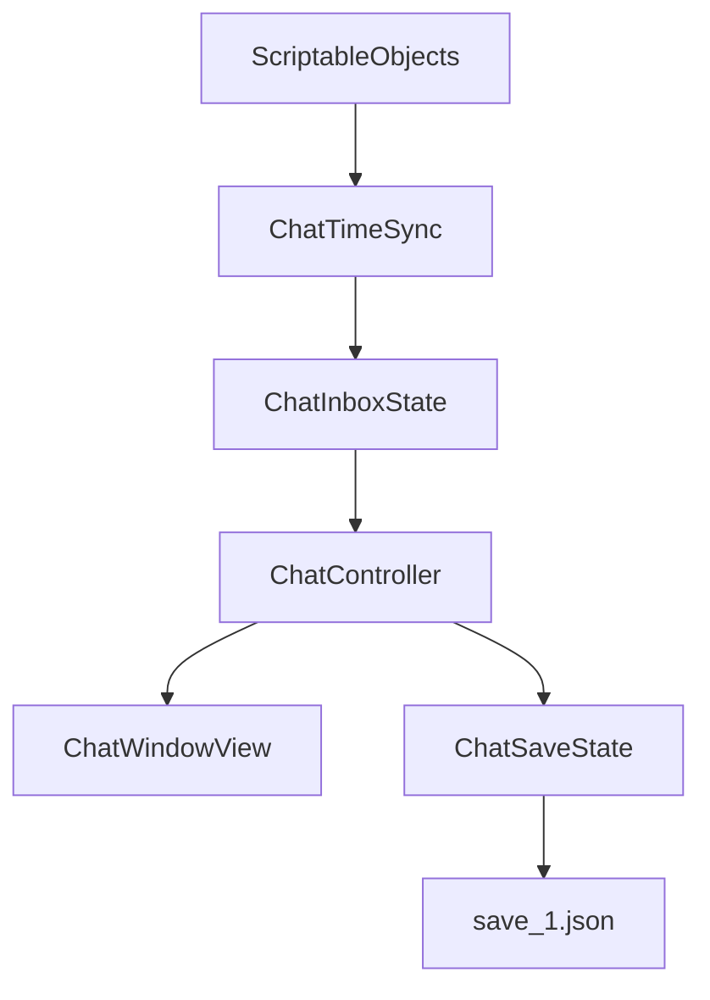

# Sistema de Chat

## Modelo

`ChatConversation` contém NPC, avatar, `startNodeId` e nós. `ChatNode` contém
mensagem, atraso de digitação, opções, próximo nó automático e flag de término.
`ChatInbox` agenda conversas por dia/hora/minuto.

## Runtime

`ChatTimeSync` ouve `TimeUpdated` e `DayChanged`, processa `ChatInboxState` e publica
`ChatConversationArrived`. `ChatController` exibe o histórico, controla escolhas e
exporta/importa `ChatSaveState`. `ChatWindowView` apenas constrói a apresentação com
os prefabs de bolhas e botões.

## Extensão

Crie IDs estáveis, conecte cada `ChatOption.nextNodeId`, adicione a entrada no
`ChatInbox` e teste o horário de chegada. Para gerar conteúdo padrão use
**Tools > Re:Senha > Gerar Conversas**.

