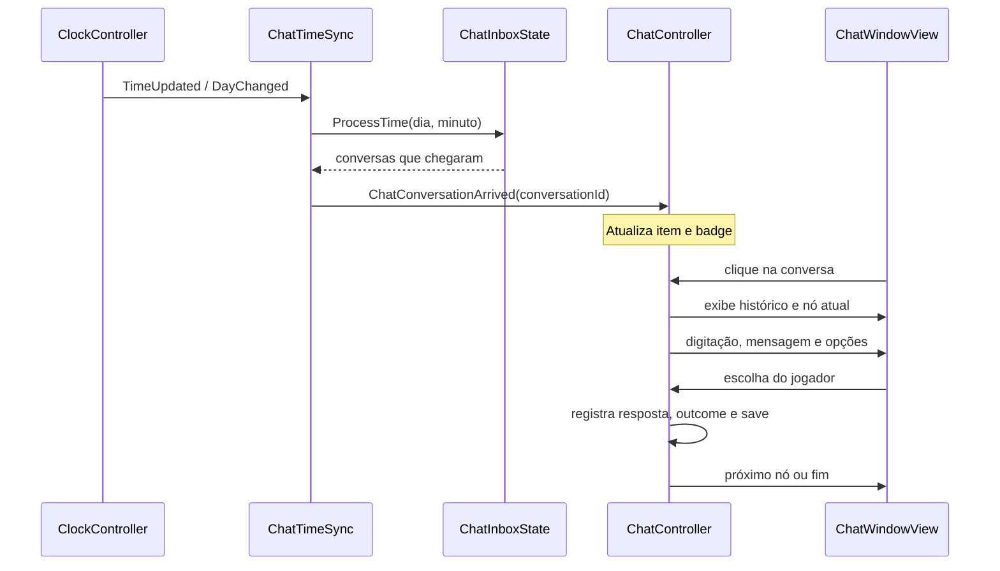

# Sistema de Chat

## Modelo de conteúdo

| Tipo | Papel e campos usados pelo runtime |
|---|---|
| `ChatConversation` | `conversationId`, nome/avatar do NPC, `nodes`, `startNodeId` e `blocksDayEnd`. |
| `ChatNode` | `nodeId`, `npcMessage`, `typingDelay`, opções, próximo nó automático, fim e agendamento opcional. |
| `ChatOption` | Texto, `nextNodeId`, resultado (`Neutral`, `Correct`, `Wrong`), feedback, impacto de pontuação e `feedbackTag`. |
| `ChatInbox` | Lista de conversas com dia/hora/minuto de chegada e `sortOrder`. |
| `ChatInboxState` | Estado em memória: chegada, não lida, término, nó atual e nós agendados já exibidos. |
| `ChatSaveState` | Estado serializado e histórico das mensagens de NPC/jogador no save. |

Os assets ficam em `Assets/Scriptable Objects/Chat/`. IDs de nó precisam ser
únicos dentro da conversa; `startNodeId`, `ChatOption.nextNodeId` e
`nextNodeIdIfNoChoice` precisam apontar para nós existentes.

## Fluxo de uma mensagem



`ChatController` salva estado e histórico em `ChatSaveState`. Ao abrir uma
conversa, o controlador marca-a como lida, reconstrói o histórico e apresenta o
nó atual. O `ChatWindowView` cuida da interface e envia o sinal
`ChatWindowCreated` ao ser criado.

## Agendamento e condições

- Uma entrada do `ChatInbox` define a chegada da conversa. Ordenação usa dia,
  horário e `sortOrder`.
- Uma conversa cujo dia já passou sem chegada não é entregue retroativamente.
- Um nó com `scheduledDay` e horário aparece quando o relógio alcança o momento.
  `requiresAnswerToNodeId` adia o nó enquanto o jogador ainda está naquele nó.
- `emailTriggerId` em um nó ou opção dispara `TriggerEmail` após `emailDelay`.
  O e-mail do dia precisa ter o mesmo `triggerId`.
- `blocksDayEnd` faz uma conversa já chegada e ainda não terminada impedir o
  fechamento do dia. Configure e teste esse campo quando a conversa for necessária
  para a atividade diária.

## Criar uma conversa pelo gerador

O menu **Tools > Re:Senha > Gerar Conversas** chama
`Assets/Editor/ChatContentGenerator.cs`. Os tipos privados `ConversationSpec` e
`NodeSpec` vivem dentro do gerador; não há um arquivo externo de spec.
Acrescente a conversa dentro de `CreateConversationSpecs()`:

```csharp
new ConversationSpec(
    "Exemplo_seguro",
    "exemplo_seguro",
    "Clip",
    1, 8, 10, 0,
    new[]
    {
        new NodeSpec(
            "inicio",
            "Recebi um pedido urgente para compartilhar minha senha.",
            Options(Option("Vou confirmar por um canal oficial.", "fim", "verificou_canal"))
        ),
        new NodeSpec("fim", "Boa decisão: nunca compartilhe sua senha.", null, null, true),
    }
)
```

Os argumentos de chegada são dia, hora, minuto e desempate. O gerador fixa
`startNodeId` como `"inicio"` e atualiza os assets na pasta `Conversations`,
`Nodes` e o `ChatInbox.asset`. Execute-o depois de editar os specs; campos dos
assets gerados são atualizados e alterações manuais nesses campos podem ser
sobrescritas. O gerador também define `npcAvatar` como `null`.

`Option(...)` cria uma opção neutra com tag. Para respostas que contam como certa
ou errada, crie/configure `ChatOption.outcome`, `outcomeFeedback` e, se necessário,
`securityScoreDelta`; a opção padrão do gerador não define esses valores.

## Edição manual e validação

Também é possível criar assets pelos menus **Create > Re:Senha > Chat** e
adicioná-los ao `ChatInbox`. `ChatConversation.OnValidate` avisa sobre início
inexistente, referências quebradas e IDs duplicados; `ChatInbox.OnValidate`
avisa sobre IDs repetidos e horários fora da faixa fixa 08:00–16:00.

**Atenção ao horário:** a cena `Desktop` está configurada com relógio até 18:00,
mas `ChatInbox.Entry` restringe o Inspector a 08:00–16:00 e sua validação também
considera 16:00 como limite. Agendamentos de chat depois das 16:00 estão
**A confirmar** e podem gerar avisos/incompatibilidade.

Exemplo de ligação:

```text
ChatConversation.startNodeId = "inicio"
ChatNode("inicio").options[0].nextNodeId = "fim"
ChatNode("fim").isEndNode = true
```

Para mensagens agendadas, teste com o dia/horário certo e também com a conversa
minimizada/fechada. Para e-mails disparados pelo chat, mantenha o `triggerId`
idêntico nos dois conteúdos.

**A confirmar:** `ChatOption.securityScoreDelta` emite `ChatSecurityScoreDelta`,
mas nenhum consumidor desse sinal foi encontrado; não trate o valor como
pontuação visível/persistida até localizar essa integração.

Veja [Ferramentas de Editor](./Editor-Tools.md), [Save](./Sistema-de-Save.md) e
[E-mails e Tickets](./Emails-e-Tickets.md).
