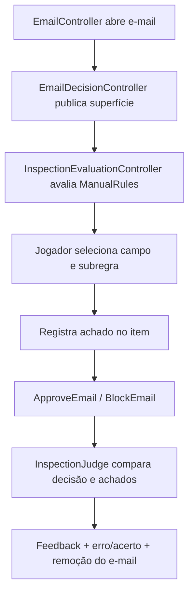

# Sistema de Inspeção

## Fluxo do jogador

No e-mail da caixa Company, abra a mensagem, ative o modo de inspeção e compare
os campos com as regras do Manual. Se encontrar uma violação, selecione o campo e
a subregra correspondente para registrar a evidência; depois escolha Bloquear.
Uma rejeição sem evidência é considerada erro mesmo quando há uma regra violada.
Se nenhuma regra aplicável for violada, aprove a mensagem.



## Responsabilidades

| Componente | Responsabilidade |
|---|---|
| `InspectionModeController` | Alterna o modo (botão ou Espaço) e publica `ModeChanged`. Espaço em campo de texto não alterna o modo. |
| `InspectionEvaluationController` | Guarda superfícies, carrega regras e calcula resultados/achados. |
| `EmailInspectionSurface` | Expõe remetente, assunto, corpo e extensões de anexos; guarda achados no `EmailData`. |
| `DatabaseInspectionSurface` | Expõe dados do colaborador como contexto. Não guarda achados e não vira o item em julgamento. |
| `ManualRules` | Carrega e valida `Resources/Manual/ManualRules.json`, filtrando por app e dia de introdução. |
| `ManualRuleEvaluator` | Executa os tipos de verificação implementados. |
| `InspectionJudge` | Conta decisão correta/incorreta, mostra feedback, remove o item e verifica o fim do dia. |
| `InspectionSignals` | Nomes e payloads dos sinais da inspeção. |

O overlay escurece a tela, mas não bloqueia a interação. Os campos selecionáveis
e as regras do Manual comunicam a seleção pelo barramento.

## Adicionar uma regra

Edite `Assets/Resources/Manual/ManualRules.json`. O formato é um objeto com
`version` e `rules`. Cada regra contém `id`, `app`, `title`, `description`,
`introductionDay`, `field` e `subrules`. Cada subregra tem `id`, `description`,
`check` e `finding`.

Exemplo compatível com o verificador de remetente:

```json
{
  "id": "rule-sender-domain",
  "app": "email",
  "title": "Verificar o domínio do remetente",
  "description": "Use somente domínios corporativos autorizados.",
  "introductionDay": 1,
  "field": "Sender",
  "subrules": [
    {
      "id": "subrule-sender-domain-example",
      "description": "O domínio deve ser exatamente um dos permitidos.",
      "check": {
        "type": "SenderDomain",
        "allowedDomains": ["empresa.com.br", "nationaltech.com"],
        "caseSensitive": false
      },
      "finding": {
        "rule": "Verificar o domínio do remetente",
        "evidence": "O domínio do remetente não está na lista permitida.",
        "explanation": "Um domínio parecido não é necessariamente o domínio oficial.",
        "reason": "Use os domínios corporativos aprovados."
      }
    }
  ]
}
```

`id` de regra e subregra precisam ser únicos. `app` aceito pelo validador:
`email`, `ticket` ou `chat`. `introductionDay` determina quando a regra aparece.
O campo da regra deve ser uma capacidade disponível na superfície.

### Tipos de `check` implementados

| `type` | Parâmetros principais | Campo/capacidade |
|---|---|---|
| `Contains` | `terms`, `caseSensitive` | Campo genérico definido em `field`. |
| `DomainNotAllowed` | `allowedDomains` | Campo genérico definido em `field`. |
| `SenderDomain` | `allowedDomains` | Remetente. |
| `SubjectTerms` | `terms`, `caseSensitive` | Assunto. |
| `BodyTerms` | `terms` ou `suspiciousDomains`, `caseSensitive` | Corpo. |
| `BodyLinkDomains` | `allowedDomains` | Domínios encontrados nos links do corpo. |
| `AttachmentExtension` | `forbiddenExtensions` | Extensão dos anexos. |

Parâmetros obrigatórios vazios, tipo desconhecido, versão diferente de `1`, IDs
duplicados ou regras sem subregras causam erro de validação/carregamento. Atualize
o avaliador ao adicionar um novo tipo de `check`.

**Limite de integração:** foram encontradas superfícies runtime para e-mail e
Database. A superfície de Database é somente contexto; nenhuma superfície de
julgamento para tickets ou chat foi encontrada. Embora `ManualRules` aceite os
nomes de app `ticket` e `chat`, a aplicação dessas regras nesses apps está
**A confirmar**.

Para conteúdo de decisão, veja [E-mails e Tickets](./Emails-e-Tickets.md); para
problemas recorrentes, [Troubleshooting e glossário](./Troubleshooting-e-Glossario.md).
