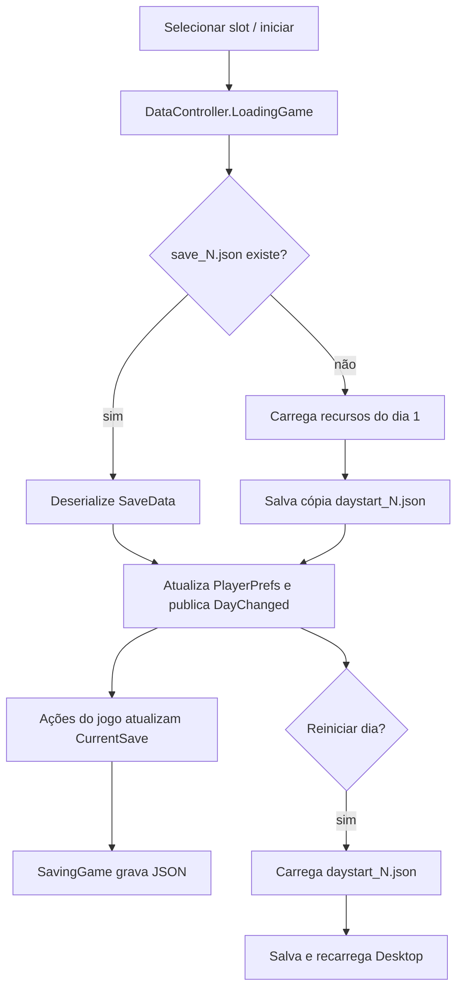

# Sistema de Save

## Arquivos e escopo

`DataController` usa `Application.persistentDataPath`. Há três slots de progresso;
o slot ativo é selecionado no menu e lembrado em `PlayerPrefs`.

| Dados | Local / mecanismo | Escopo |
|---|---|---|
| `SaveData` | `save_1.json`, `save_2.json` ou `save_3.json` | Um arquivo por slot. |
| Cópia do começo do dia | `daystart_1.json` etc. | Uma cópia do dia atual por slot, usada pelo reset do dia. |
| `MetaData` | `data.json` | Global, não separado por slot. Inclui wallpaper, achievements, trinkets e estatísticas. |
| Preferências | `PlayerPrefs` | Slot escolhido, dia/erros atuais, limites e volumes; preferências não são parte do JSON do slot. |

Os nomes acima são relativos à pasta persistente da plataforma. Use a API
`DataController`; não dependa de um caminho fixo do sistema operacional.

## Modelo serializado

| Classe/campo | Conteúdo |
|---|---|
| `SaveData.current_day`, `error_count`, `current_hour`, `current_minute` | Progresso e relógio do expediente. |
| `availableMails` | E-mails do dia que ainda aguardam entrega. |
| `currentMailBoxes` | Caixas User/Company e mensagens recebidas. |
| `tickets` | Chamados ainda disponíveis para decisão. |
| `chatStates` | Estado e histórico por conversa (`ChatSaveState`). |
| `seenTips` | IDs de dicas do Companion já exibidas naquele slot. |
| `MetaData.currentBackground` | Nome do sprite selecionado. |
| `MetaData.achievements`, `unlockedTrinkets`, `statistics` | Modelos de metadados; `StatisticsData` está vazio. |

`JsonConvert.SerializeObject(..., Formatting.Indented)` e
`JsonConvert.DeserializeObject` do Newtonsoft são usados no JSON. Dados diários
são carregados de `Resources/Emails/Dia_N.json` e `Resources/Tickets/Dia_N.json`.
Anexos de e-mail são reconstruídos como subclasses de `AttachmentContent` conforme
as propriedades encontradas no JSON.

## Ciclo de vida

`CurrentSave` carrega o save se ainda não estiver em memória.
`LoadingGame()` publica `DayChanged` e normaliza o arquivo ativo; `SavingGame()`
atualiza o JSON e, quando aplicável, os campos do relógio.
`ChatController` exporta `ChatSaveState` para `SaveData.chatStates`.

## Reiniciar dia e jogo

- `ResetDayAndReload()` restaura a cópia do início do dia para o slot atual e
  recarrega a cena `Desktop`. Se o snapshot não existir (save antigo), remonta o
  estado inicial do dia a partir dos recursos. Dicas já vistas durante o dia são
  preservadas na lista `seenTips`.
- `ResetGame()` apaga o arquivo de save e o snapshot **do slot atualmente ativo**,
  reinicializa o save desse slot e não apaga `data.json`.
- Avançar além de `MaxDay` reinicia o save e carrega `GameWin`; atingir
  `MaxErrors` leva a `GameOver`.

Ao alterar modelos serializados, considere saves existentes e dados ausentes.
Não edite saves de jogador como conteúdo de jogo. Para autoria de e-mail, ticket
ou dicas, consulte [E-mails e Tickets](./Emails-e-Tickets.md) e
[Companion e Tutorial](./Companion-e-Tutorial.md).
